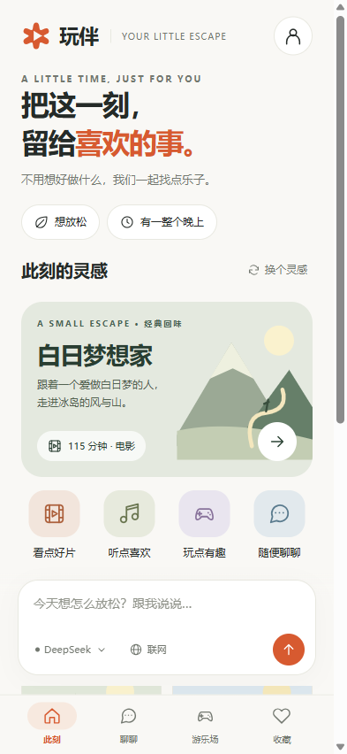
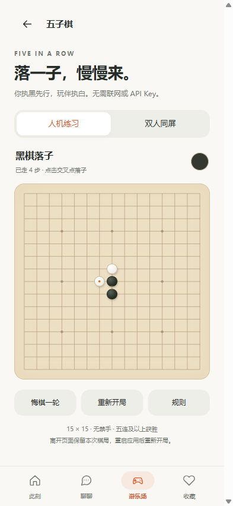
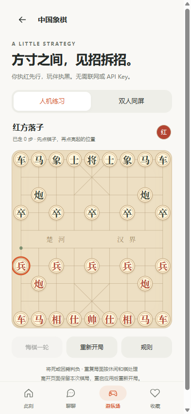

# 玩伴

一个免登录的 Android 个人娱乐助手。说一句心情，找一部电影、一首歌、一个小游戏，或者随便聊聊。

当前交付：**0.2.0 个人预览版**。Android 8.0 / API 26 及以上，建议更新 Android System WebView（108及以上）。安装包与源码见下方发布页。

**[下载安卓 APK](https://github.com/taonian1989-hub/wanban-android/releases/tag/v0.2.0-preview.1)** · **[版本说明](CHANGELOG.md)** · **[使用说明](docs/使用说明_v1.md)**

  

截图来自 APK 同一套资源的浏览器预览，并非安卓真机截图。AI 演示截图使用模拟响应，不代表实网模型输出。

## 开始使用

1. 将 APK 传到安卓手机，按系统提示允许安装该来源，打开即可使用，无需账号。
2. 在「此刻」选择心情与空闲时间。未连接模型时，可浏览本地精选、收藏作品，玩五子棋、中国象棋、知识局或二选一。
3. 右上角 → 偏好与连接 → DeepSeek、Kimi、GLM 或自定义，填写自己的 API Key，保存并测试连接。预设模型 ID 可编辑。
4. 在首页输入需求，例如「我有半小时，想轻松一点，不要恐怖片」。AI 回复中的作品卡片可以加入收藏。
5. 需要联网时，先配置 **GLM 官方地址与 Key**，再打开输入框下的「联网」。聊天可继续使用 DeepSeek 或 Kimi。
6. 在设置中主动导出备份。卸载、清除数据或更换手机前先备份。

详细说明见 [使用说明](docs/使用说明_v1.md)、[新增棋类游戏说明](docs/棋类游戏说明_v2.md)，本轮验证见 [0.2.0验收记录](docs/验收记录_v2.md)。

## 功能与交互

| 入口 | 能做什么 |
| --- | --- |
| 此刻 | 心情与空闲时间、本地精选、分类筛选、换个灵感；短空闲优先推荐音乐 |
| 聊聊 | 多轮对话、流式回复、停止、重试、复制、可选思考展示、历史会话 |
| AI 推荐卡 | 影视、音乐、游戏与活动建议，直接加入统一收藏；无评分或播放能力假象 |
| 游乐场 | 五子棋、中国象棋（离线人机/双人、悔棋、胜负）；8题知识局、6组二选一及AI互动故事 |
| 收藏 | 统一清单、关键词搜索、想体验/体验过、手动添加与移除确认 |
| 模型 | 四个独立配置槽，Chat Completions SSE/JSON，连接测试和移除密钥 |
| 搜索 | 独立 GLM Web Search，最多8条来源，外部浏览器核查，失败明确提示 |
| 个性化 | 兴趣方向、日间/夜间/跟随系统、主动选择是否附带偏好与收藏标题 |
| 数据 | 安卓加密原子保存、完整明文JSON备份与恢复预览；损坏时暂停写入 |

默认没有账号、云同步、广告、遥测或自建中转服务器。没有付费内容播放、音乐播放、电影资源库或应用商店购买能力。可以使用系统输入法的语音输入；没有独立语音识别或声音陪伴。

## 接口与隐私

三家模型通过用户自己的 HTTPS API 地址直连，服务商自行计费。本应用不提供 Key 或额度，不能使用消费端会员代替 API Key。默认模型 `deepseek-flash`、`kimi-k3`、`glm-5.3` 是可编辑起点，以账号权限和服务商实际可用性为准。

安卓宿主使用 Android Keystore / AES-GCM，分别加密密钥与个人快照，禁用系统自动备份；只申请网络权限。密钥读取接口只返回是否保存。更改 API 地址需重新填写 Key，携带 Key 的请求不跟随重定向、不自动重试。网页内容在系统浏览器打开，不接入应用桥。

每次模型调用会发送**当前会话、设备日期**。偏好共享默认关闭；开启后额外发送当前心情、空闲时间、兴趣和前20条收藏的标题、类型、体验状态，不附带收藏备注或其他会话。切换服务商开启新会话；历史会话固定使用原服务商。

联网默认关闭。开启后，将本次输入前128个Unicode字符发送给 GLM 官方搜索，返回摘要再发送给当前聊天模型。只接收HTTP(S)来源，最多8条，每条摘要最多6000字符。不抓取全文；引用和AI推荐仍需核实。只有配置为官方地址的 GLM Key 才能用于官方搜索。

**备份为明文，包含对话、收藏和偏好，不包含模型密钥。** 卸载或清除数据会移除本机内容；没有服务器可恢复。浏览器预览使用浏览器本地存储，禁用真实 Key 配置，不能代表安卓加密验证。

## 构建与验证

Java Android 宿主 + 随包 HTML/CSS/JavaScript，不依赖线上网页或前端运行包。可用 Android Studio（JDK17、SDK35、AGP8.9.2、Gradle8.11.1）打开，或使用本项目 PowerShell 工具。

```powershell
pwsh -File scripts/provision_android.ps1
pwsh -File scripts/build_apk.ps1
node tests/core_test.cjs
node tests/board_games_test.cjs
pwsh -File scripts/test_protocol.ps1
node scripts/serve_preview.cjs
```

已有工具链可通过 `-ToolRoot` 指定，内部包含 `jdk/<JDK目录>`、`platform/android-35`、`build-tools/android-15`。源码不附 Gradle wrapper。协议测试只在本机模拟服务器运行，首次下载固定版本 `org.json` 并验证 SHA256，不打进APK。端口8804的预览仅监听127.0.0.1。

界面检查通过 Playwright CLI 的 `run-code --filename` 运行 `tests/ui_smoke.js` 与 `tests/ai_edges.js`，需分别使用全新、隔离的浏览器会话，勿用于存有个人记录的会话。后者只注入测试用原生桥，无真实付费请求。`tests/capture_preview.js` 会重置预览数据生成截图。

预览包使用本项目 `work/signing/personal-preview.keystore` 签名；请保留该文件用于同签名升级，私钥不含在源码 ZIP 中。发布 APK 的 SHA256 见 Release 附件中的 `SHA256SUMS_0.2.0.txt`。

## 目录、验收与已知边界

`app/` 是安卓项目；`scripts/` 是构建工具；`tests/` 是核心与协议及界面检查；`docs/` 为产品、接口、使用和验收说明；正式交付统一 `outputs/`；构建、签名和中间资源进入 `work/`。当前交付版本为0.2.0。

最大1000条收藏、30段会话、每段20轮，总快照约5百万UTF-16字符。长模型回答或长思考也可能提前达到上下文上限，需新建会话。结构化推荐由模型遵循提示词产生；未产生有效结构时展示普通回复。生成未完成时需重试或新建会话，不将不完整回答继续发给模型。

初版已通过156项检查；0.2.0新增44项棋类规则与37项棋盘界面检查，并回归原有核心、界面与模拟AI交互。已完成APK签名验证，**没有使用真实模型Key、没有连接安卓真机或模拟器进行运行验收**。安装、Keystore实际写入、键盘及系统文件选择器、返回键与系统主题、网络连通性和各服务商计费权限仍需真机联调。知识局题目与二选一为固定本地内容，非无限生成。


本项目采用MIT许可证。复用的网络、加密与构建代码来源见 [第三方声明](THIRD_PARTY_NOTICES.md)。

## 0.2.0 棋类游戏

游乐场新增五子棋和中国象棋，均支持完全离线的人机练习与双人同屏。悔棋在人机模式撤回一轮，双人模式撤回一步；重新开局或切换已有棋局的模式前先确认。页面切换保留当前棋局，应用重启后不保留。

五子棋为15×15自由规则，五连或以上获胜，无禁手。中国象棋检查棋子走法、自将与照面、将死及困毙；采用休闲和棋约定，不处理比赛中的长将长捉责任。电脑是本机入门算法，不调用大模型。

独立浏览器预览可从 [0.2.0 Release](https://github.com/taonian1989-hub/wanban-android/releases/tag/v0.2.0-preview.1) 下载，浏览器不接收真实密钥。也可运行 `node scripts/package_preview.cjs` 在本地生成。仓库不存放APK、私钥或个人数据，正式附件位于Release。
